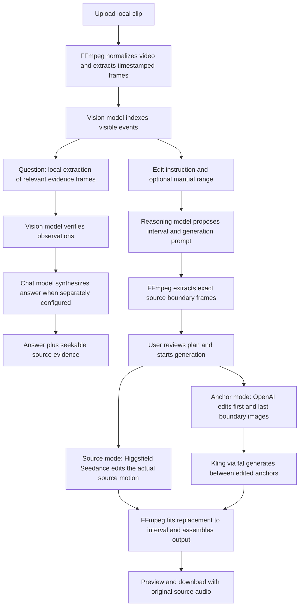

# Aurrra Video Lab

An isolated, local hackathon prototype: upload a short video, ask questions with timestamped evidence, then describe a visual change and generate a replacement for a selected interval. The activity panel shows which provider and model actually ran, what stage completed, and the frames used along the way.

This project runs independently of the Aurrra repository. It does not import the production service, load its environment files, connect to its database, or require its deployment infrastructure.

## Run locally

Requirements: **Python 3.11+** and **FFmpeg**, including `ffprobe`. No Node.js or frontend build is required. Model API calls need internet access; the illustrated demo runs locally without keys.

```bash
cd vidset

# macOS, if FFmpeg is not already installed:
brew install ffmpeg

./run.sh
```

Open **[http://127.0.0.1:8765](http://127.0.0.1:8765)**. The launcher creates `.venv` if needed and installs the runtime dependencies when missing. On Ubuntu, install FFmpeg with `sudo apt install ffmpeg`. Stop the server with `Ctrl+C`. To choose another local port, run `PORT=8766 ./run.sh`.

Manual setup, if preferred:

```bash
python3 -m venv .venv
.venv/bin/python -m pip install -r requirements.txt
.venv/bin/python -m uvicorn app.main:app --host 127.0.0.1 --port 8765
```

## Try the complete interface without keys

1. Open the **demo sample** to load the illustrated neighborhood walk.
2. Ask “When does the person pick up the tool?” or “What changes between the beginning and the end?” Click evidence frames to seek the source video.
3. Switch to editing and request “Add a swing to the tree and make the hydrant yellow.” Use the default demo selection or choose a valid interval.
4. Review the proposed range, source boundary frames, and prompt. Generate the replacement, preview the result, and download it.

The sample is **explicitly scripted**: its answers come from known fixture events, and its edit is a deterministic graphics change. It makes no model calls, even when API keys are configured. It demonstrates the workflow, not AI quality. Arbitrary uploads need a configured vision model for answers and planning.

## Preview other surroundings

The four setting cards sit below the conversation and **Under the hood** in a **2 × 2 grid**: golf course, music festival, courtside seats, and airport lounge.

Opening a real upload automatically creates four **still images** with the configured OpenAI image model (one image request per setting). The source is a timestamped frame at 75% of the clip, capped at 29 seconds. Results are saved per video and reused when switching videos or refreshing. Missing previews can be retried explicitly; successful images are not regenerated. This uses your OpenAI key and its image-generation rates.

Only **Generate video** starts full video work: the app prepares a source-video plan, then sends the selected original footage and setting prompt to the configured video editor. Existing completed versions reopen without a new generation. Each generated video is saved separately from the original and beach edit. A still preview is a concept for the setting, not an exact promise of the generated motion. The gallery never starts video generation on page load, refresh, scroll, or hover.

## Connect models

Use the **Models/Settings** dialog or create a project-local environment file:

```bash
cp .env.example .env
# Edit .env with your own API keys, then restart the server.
```

| Stage | Default | Required key |
| --- | --- | --- |
| Visual analysis and evidence verification | Gemini `gemini-2.5-flash` | `GEMINI_API_KEY` |
| Chat synthesis and edit planning | OpenAI `gpt-4.1-mini` | `OPENAI_API_KEY` |
| Edit source footage and preserve its motion | Higgsfield `bytedance/seedance-2.5/video-edit` | `HIGGSFIELD_API_KEY` (`KEY_ID:KEY_SECRET`) |
| Still previews and first/last boundary images | OpenAI `gpt-image-1.5` | `OPENAI_API_KEY` |
| Generate motion between edited images | fal.ai `fal-ai/kling-video/o1/image-to-video` | `FAL_KEY` |
| Optional vision/chat alternative | Anthropic `claude-sonnet-4-6` | `ANTHROPIC_API_KEY` |

Vision and chat can each use Gemini, OpenAI, Anthropic, or the fal model router; model IDs are editable. The configured provider and model must match, and your account must have access. A different video endpoint must support the same first/last-frame input schema; editing the model ID does not adapt incompatible APIs automatically.

**OpenAI + Higgsfield works without Gemini:** use OpenAI for vision/chat and Higgsfield for source editing. Available keys automatically replace an unavailable default route. **A fal key alone also supports all three roles:** use the Settings shortcut to select Gemini via fal, OpenAI reasoning via fal, and Seedance source editing via fal. It authenticates models hosted by fal, not the separate providers’ direct APIs.

**One vision-provider key is enough to start.** Select that provider and its model in Settings. If the chosen chat provider has no key, the app uses the configured vision model for reasoning. A second call is made when the selected chat provider/model differs and is configured; the activity panel identifies both actual calls. To demonstrate a multi-model flow, use Gemini for vision and OpenAI or Anthropic for chat. Source-video editing requires a Higgsfield API key pair or a fal key and its source-edit route. The alternative anchor workflow requires OpenAI and fal.ai keys. A connected Higgsfield account in Codex does not automatically configure this standalone app; obtain an API key pair for the app separately.

Keys entered in the interface remain in server memory until restart; they are not saved in browser storage or returned by the config API. Model changes made there also last for that server session. A `.env` file persists the settings on your disk and is ignored by Git. Do not share it. This project reads only its own `.env` and the launching process's environment, not Aurrra's production environment.

Analysis, chat, planning, and generation use your own provider accounts and can incur charges. In source-video mode, the generation button uploads the selected silent source clip to the chosen Higgsfield or fal route and begins one Seedance video-edit request. In anchor mode it begins two image-edit requests and a fal video-generation request. Provider errors are reported; the app does not substitute scripted results for a failed real API call.

## What happens under the hood

### Model choices and Prelint

The compact **Model choice** card shows the selected model and one reason. Expand **Model options** to see the alternatives, missing keys, and incompatible input types. Each job freezes its routing configuration so the display matches the model actually called. The versioned `model-routing.json` policy prefers a configured, compatible catalog model, then the first eligible route with a key. Custom model IDs must be added to `app/routing.py` and the policy before they can be selected by this router.

Prelint reviews these product rules through the repository's `prelint.json`; it is not a model inference API. The badge stays **Prelint · pending** until a real Prelint GitHub check has completed successfully for the current commit and unchanged policy. With GitHub CLI authenticated, sync that evidence using:

```bash
.venv/bin/python scripts/sync_prelint_review.py
```

The receipt stays in ignored `.prelint/` and contains no credentials. Connect the Prelint GitHub App to **4horizons/vidset** for automatic pull-request review; installing an organization app may require its owner. To connect a teammate's Codex agent to Prelint's decision ledger, use the official OAuth MCP server:

```bash
codex mcp add prelint --url https://app.prelint.com/mcp
# Complete the browser sign-in when prompted.
```

No Prelint API key is required. Agent MCP access and repository review access are separate connections. See [Prelint MCP setup](https://prelint.com/docs/mcp) and [review configuration](https://prelint.com/docs/configuration).



Gemini and the fal video router receive a compressed whole-video proxy. OpenAI and Anthropic analysis receive timestamped sampled stills. Follow-up questions use a fresh selection of stills, with denser sampling near matching events. Evidence captions are accepted only for timestamps of frames actually supplied to the vision model. A separate chat model receives the verified observations for concise synthesis.

For edits, manually selected bounds take precedence. If the model cannot locate the requested moment from the analysis, select the interval yourself. The app shows original anchors before generation, then exposes the edited anchors and model activity as the job proceeds. These are observable workflow events and brief decisions, not hidden model reasoning.

**Source-video mode** is the default for real uploads. It sends the selected 4–30 second interval to Seedance 2.5 via Higgsfield or fal. The plan states what changes and what must remain, including subject identity, labels, camera motion, and when a subject enters the frame. The original boundary screenshots are evidence, not generation inputs. Result screenshots come from the actual edited video. A review note makes clear that visual fidelity still needs checking; there is no automated pass/fail claim. The editor disables generated audio, then FFmpeg restores the original normalized audio.

**Anchor mode:** Kling O1 accepts whole-second durations from 3–10 seconds. For a shorter or fractional selection, the adapter requests the next supported duration and FFmpeg retimes the full generated clip to fit the exact local selection.

## Source provenance

The pre-existing Aurrra project was found at:

```text
/Users/jonathancruz/Desktop/content-engine
```

The complete service was preserved as [reference/aurrra-main.py.snapshot](../reference/aurrra-main.py.snapshot), copied byte-for-byte from **`python-service/main.py`** (4,902 lines). The [source map](../reference/SOURCE_MAP.md) records its hash, relevant functions and routes, and related YouTube, Instagram, transcription, and fal integrations. The original license is preserved alongside it.

The existing research feature analyzes **transcripts/captions** with Claude. It is not already a frame-grounded video Q&A engine. Its original prompt is saved in [reference/research_prompt.txt](../reference/research_prompt.txt); this prototype adapts its **hook, structure, style, and key-insights taxonomy**, while adding visual analysis, frame evidence, localized generation, and local assembly. It avoids assuming an available transcript or inventing speech from still images.

The source snapshot is for reference and is never imported or executed. No original repository files were changed. YouTube/Instagram URL ingestion and discovery are **not implemented in this standalone app**; download a clip you can use and upload the local file. The original social ingestion code remains available in the snapshot for a later integration.

## Limits and practical expectations

- Uploads: **128 MB maximum, 120 seconds maximum**; MP4, MOV, WebM, MKV, M4V, and AVI. The browser copy is normalized to H.264/AAC at 24 fps, fitting within 1280 × 720 (landscape) or 720 × 1280 (portrait), preserving aspect ratio. Source-video editing requires at least four seconds; anchor editing requires one second.
- Edit selections: **4–30 seconds for source video, 1–10 seconds for anchors**, inside the clip, quantized to normalized video frames. Each result starts from the unchanged normalized source; edits are not cumulatively stacked.
- Timing is approximate. Whole-video model sampling, the compressed proxy, sparse frames, and model interpretation can miss brief actions. Evidence images are actual extracted frames; an estimated event interval is not a guaranteed exact onset.
- OpenAI/Anthropic analysis does not inspect audio or motion between stills. Gemini receives the video proxy, but there is no dedicated word-timestamp transcription pipeline here. Follow-up evidence verification uses stills and does not recheck audio.
- Source-video editing supplies motion context, but can still alter branding, geometry, camera timing or unrequested details. Compare the original and result before using it.
- First/last-frame conditioning constrains generated output but does not guarantee exact pixels, motion, identities, or unchanged background details. Independently editing the two anchors can introduce inconsistent changes. Generated motion can drift, and seams can remain visible at the replacement boundaries.
- The original normalized source audio is retained across the full export. Audio from the generated replacement is ignored. A visual edit therefore does not automatically alter dialogue, footsteps, or other sounds.
- Normalization and assembly re-encode video; outputs are not lossless copies. Anchor images are resized to the source canvas when needed. Kling requires an anchor aspect ratio between 0.4 and 2.5.
- Provider request formats were checked against official documentation and tested with mock HTTP responses. **The supplied LaCroix beach case was submitted through the connected Higgsfield tool using Seedance 2.5. OpenAI evidence Q&A was also verified live with the owner’s key. The standalone Higgsfield source-video adapter was also verified live on a LaCroix golf-course edit. Other provider routes remain contract-tested with mocked HTTP.** Model access, billing, latency, and output quality depend on your accounts.
- This is a single-process local prototype. Active job status is not durable across a server restart. Completed Q&A is saved per video on the server; draft text, playback position and viewing preferences are restored by the same browser. A remote generation can continue after the local server stops or times out. Saved fal queue tickets allow a retry of the same edit to resume or redownload the existing request instead of submitting a second paid generation. A confirmed remote failure requires a new edit plan; an ambiguous submission or unreadable ticket requires checking fal history first.

## Files and local storage

```text
app/main.py             FastAPI endpoints, jobs, configuration, orchestration
app/providers.py        Gemini / OpenAI / Anthropic / fal REST adapters
app/source_editor.py    Higgsfield source-video editor and durable request recovery
app/media.py            FFmpeg normalization, sampling, and clip assembly
app/demo.py             Explicitly scripted sample and graphics edit
app/static/             Buildless HTML, CSS, and JavaScript interface
reference/              Complete source snapshot, original prompt, source map
data/                   Local video assets and saved analysis/edit metadata
```

All video assets and saved metadata live under `data/<video-id>/`: normalized `video.mp4`, analysis proxy, evidence frames, and per-edit anchors, generated clips, and final outputs. The raw upload is retained as `original.bin` and cannot be served through the media route. **The normalized source is retained and never overwritten by an edit**; each result is saved separately and can be downloaded in the interface. Keep your own original uploaded file if you need its exact original encoding.

Video/analysis/edit metadata and completed edit run events survive server restarts; the running job registry is in memory. The UI labels restored execution records as saved runs. Each fal video-generation request also saves a private `replacement.job.json` queue ticket with input hashes, request ID, and queue URLs; it contains no API key and cannot be fetched through the media route. Higgsfield source edits save `replacement.higgsfield-job.json`, including the exact request body and idempotency key. A retry resumes the saved request or repeats its exact idempotent submission; it does not intentionally start a new paid generation. These ticket files and source originals are not served by the app. To remove locally saved clips, stop the server and remove the corresponding folders under `data/`. No media is uploaded to a provider until a real model operation needs it. Real operations send the relevant video proxy, images, prompts, and/or observations to the selected provider.

The launcher binds to `127.0.0.1`. Keep this local prototype on loopback; it has no account/login system intended for a shared or public deployment.

## Development and verification

```bash
.venv/bin/python -m pip install -r requirements-dev.txt
.venv/bin/python -m pytest -q

# Provider contract tests alone, with no paid API calls:
.venv/bin/python -m unittest discover -s tests -p 'test_providers.py' -v
```

Provider tests cover whole-video versus still-image payloads, multi-model synthesis, exact evidence-frame mapping, single-key behavior, fixed edit ranges, image edit requests, fal queue states and resume behavior, safe downloads, malformed responses, and error sanitization. Local media tests require FFmpeg.

The running API documentation is at [http://127.0.0.1:8765/docs](http://127.0.0.1:8765/docs). [CONTRACT.md](../CONTRACT.md) documents the UI/backend contract. Basic availability check:

```bash
curl http://127.0.0.1:8765/api/config
```

If analysis fails, check the selected provider/model and that provider's key in Settings. For a failed real generation, inspect the activity panel and provider dashboard before retrying; a remote job may have completed even if the local connection failed. Keys and raw provider error bodies are excluded from displayed errors.

Source-edit references: [Seedance 2.5 video-edit API](https://open.higgsfield.ai/models/bytedance/seedance-2.5/video-edit/api-reference), [Higgsfield uploads](https://docs.higgsfield.ai/docs/concepts/file-uploads), and [Higgsfield idempotency](https://docs.higgsfield.ai/docs/concepts/idempotency).

Official integration references: [Gemini video understanding](https://ai.google.dev/gemini-api/docs/generate-content/video-understanding), [OpenAI vision](https://developers.openai.com/api/docs/guides/images-vision), [OpenAI image edits](https://developers.openai.com/api/reference/resources/images/methods/edit), [Claude vision](https://platform.claude.com/docs/en/build-with-claude/vision), [Kling O1 first/last-frame API](https://fal.ai/models/fal-ai/kling-video/o1/image-to-video/api), and [fal asynchronous queue](https://fal.ai/docs/documentation/model-apis/inference/queue).

## Recorded can walkthrough

Open **Judge demo** in the app header for the completed LaCroix beach example. The self-contained HTML embeds both videos, boundary evidence, actual model provenance, and seven guided stages (six recorded stages plus one explicitly simulated Prelint policy check). It automatically plays the muted before/after videos on a synchronized loop and runs a guided, animated tour that scrolls through each stage and highlights its relevant evidence. Pause the tour or scroll to take over; reduced-motion preferences disable automatic motion until Play or Start tour is selected. It does not make new model calls. The live activity sidebar separately tracks real job events, actual provider/model names, elapsed time, failures, and cached steps.

## Video library

Use **Video library** in the header or **Browse saved videos** above the player. Search filenames or analyzed scene descriptions, open any saved clip, or select **Upload new video**. Each upload gets its own directory; it never overwrites another video or its edits. Original footage, analysis, up to 200 Q&A messages, and generated edits live in this workspace. The browser remembers the active video, draft, selected interval, editing mode and playback position. The shared instance has its own library, separate from the local instance.
